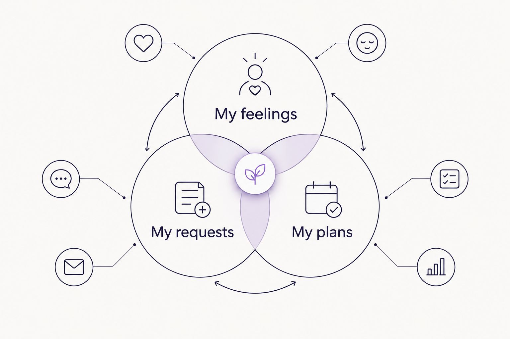

---
# Generated by import_ryze.py. Edit the source JSON in blog/data instead.
layout: "post"
title: "Healing journal for caregivers: complete 2026 guide"
seo_title: "Healing journal for caregivers: Keep it gentle | 2026"
description: "A healing journal for caregivers works best without daily pressure. Find gentle prompts, flexible formats, and room for your needs alongside caregiving."
date: "2026-11-02T21:40:26.158000+00:00"
last_modified: "2026-11-02T21:40:26.158000+00:00"
permalink: "/healing-journal-for-caregivers-complete-guide/"
ryze_source: "blog/data/healing-journal-for-caregivers-complete-guide.json"
category: "Real life"
category_key: "lifestyle"
edit_type: "The edit"
cover_note: "Healing journal for caregivers: complete 2026 guide"
read_time: "9 min read"
---

A caregiver healing journal is a place for personal reflection with the aim of making room for your needs alongside the care you give. In this 2026 guide, a healing journal for caregivers means honest writing without a daily assignment, a promise of recovery, or another person to look after: the notebook.

TL;DR
<ul><li>A healing journal for caregivers is for reflection, not medical treatment or another daily obligation.</li><li>The Sheema Edit suits caregivers seeking thoughtful essays and printable journals without pressure to turn reflection into productivity.</li><li>Start with one honest sentence; use an undated weekly planner only when you want somewhere to put practical next steps.</li><li>Keep personal reflection separate from care records, and stop writing whenever you want.</li></ul>
<h2>Why journaling matters for caregivers</h2>

When you care for someone, a question like “How are things?” can turn into an update about them. Their appointments. Their sleep. What they need next. Your own answer can get lost somewhere between the calendar and the laundry.

A journal gives you somewhere to answer a different question: <strong>How am I inside all of this?</strong> You don&#x27;t have to make the answer useful, gracious, or ready for anyone else to read.

<a href="https://thesheemaedit.com/" rel="noopener noreferrer">The Sheema Edit</a> brings together essays on mental wellness, motherhood, and chronic illness alongside printable journals and planners. <strong>The Sheema Edit is best for caregivers who want relatable essays and printable space for personal reflection.</strong>

For moms who are also caregivers, this isn&#x27;t an invitation to become better at carrying everything. It&#x27;s permission to notice what you&#x27;re carrying. Whether you&#x27;re beginning in 2026 or returning after a long pause, the blank page doesn&#x27;t need an explanation.

<h2>What a healing journal can and cannot do</h2>

Here, “healing” describes the intention you bring to writing, not a result a notebook can guarantee. You can write about disappointment, tenderness, anger, or the strange combination of loving someone and wanting an afternoon alone.

A journal can hold your words. It cannot replace practical help, professional care, or another adult taking responsibility for something that needs doing.

You also don&#x27;t owe the page your hardest memory. A shopping list followed by “I miss having choices” is a perfectly real entry. So is a paragraph about something good that happened without adding a disclaimer about everything still being difficult.

<strong>Choose a journal that leaves room for your actual feelings, not just the acceptable ones.</strong> If a prompt feels intrusive or asks you to find a lesson you don&#x27;t have, leave it unanswered.

<h2>How to begin without creating another obligation</h2>

These suggestions are a menu, not a routine. Take the part that fits your life and leave the rest sitting quietly on the page. Nobody needs to supervise your notebook attendance.

<h3>Choose your space</h3>

Start with something you already have: a spare notebook, loose paper, or a private note on your device. You don&#x27;t need to shop before you&#x27;re allowed to have a thought.

Think about privacy before appearance. If other people share your home, devices, or caregiving paperwork, choose a place where personal writing won&#x27;t be mistaken for information they need to read.

Try a 2 minute entry if a smaller boundary makes beginning feel easier. That&#x27;s an optional stopping point, not a claim about how long reflection should take.

<ul>
<li>Choose somewhere you can leave an entry unfinished.</li>
<li>Keep private writing apart from shared care instructions.</li>
<li>Use a format you can comfortably read and write in.</li>
<li>Decide whether you&#x27;ll keep, delete, or discard the entry afterward.</li>
</ul>
<h3>Name your needs</h3>

Before writing about what everyone else needs, try naming something you need. It doesn&#x27;t have to be reasonable, available today, or something you can immediately arrange.

“I need quiet” and “I need someone else to make the decision” are different answers. Let the page be specific without making yourself responsible for solving either one immediately.

If an open page feels too wide, choose 1 sentence to finish. You can stop there, even if the sentence is messy or ends with a question mark.

<ul>
<li>“What I wish someone would ask me is…”</li>
<li>“The part I&#x27;m finding difficult today is…”</li>
<li>“Something I need that isn&#x27;t another task is…”</li>
<li>“One thing I don&#x27;t want to explain right now is…”</li>
</ul>
<h3>Pick your format</h3>

A plain notebook gives you room to write anything, but it also leaves every starting decision to you. A printable journal gives you a page to begin from, though its prompts might not fit every day.

The Sheema Edit offers printable journals and planners alongside its essays. Consider a printable only if having something on paper genuinely suits you; there&#x27;s no requirement to replace a notebook that already works.

For a healing journal for caregivers in 2026, the useful distinction isn&#x27;t impressive versus ordinary. It&#x27;s whether the format asks less of you than it gives you room to express.

<ul>
<li>Use blank paper when you want freedom from prompts.</li>
<li>Choose prompts when you want help finding an opening sentence.</li>
<li>Check page previews and descriptions before choosing a printable.</li>
<li>Leave any section blank that doesn&#x27;t belong to your experience.</li>
</ul>
<h3>Separate reflection from planning</h3>

Some thoughts want attention, not an action item. “I&#x27;m lonely” doesn&#x27;t have to become a social calendar before you&#x27;ve even finished writing it.

When a practical need does emerge, you can move it onto a separate weekly page. For example, “I want less rushing” might lead to a request for someone else to handle an errand. It might also remain a feeling for now.

Use these 3 distinctions to decide what belongs where. A journal can hold all of them, but a planner only needs the parts you actually want to arrange.

<ul>
<li><strong>My feelings:</strong> what you want to say without fixing it.</li>
<li><strong>My requests:</strong> help you want to ask another person for.</li>
<li><strong>My plans:</strong> something you&#x27;ve chosen to put on a calendar.</li>
</ul>
<figure><figcaption>A feeling can stay a feeling without becoming another assignment.</figcaption></figure><h3>Protect your boundaries</h3>

You don&#x27;t have to share an entry to prove that you&#x27;re communicating. Private reflection and a conversation with someone else are different choices.

You can use writing to find a sentence you&#x27;d like to say aloud, then keep the rest to yourself. If you&#x27;re looking for a starting point, these <a href="https://thesheemaedit.com/self-reflection-journal-prompts-for-boundaries" rel="noopener noreferrer">journal prompts for boundaries</a> offer a related direction to explore.

Keep sensitive details about the person you care for out of a personal entry unless they&#x27;re necessary to what you want to express. Your feelings deserve space without turning the notebook into another person&#x27;s record.

<ul>
<li>Write about your experience rather than documenting someone else&#x27;s private details.</li>
<li>Mark personal pages clearly if they sit near shared paperwork.</li>
<li>Choose what, if anything, you want to discuss outside the journal.</li>
<li>Skip questions that ask for more than you want to give.</li>
</ul>
<h3>Return without catching up</h3>

An undated page doesn&#x27;t need you to account for the days between entries. You can open it after an appointment, on an ordinary Sunday, or weeks after you last touched it.

If you&#x27;ve stopped using a journal in 2026, returning doesn&#x27;t require a fresh notebook or a declaration that this time will be different. Begin with what&#x27;s true now. The missing entries aren&#x27;t unfinished work.

You can also decide that writing isn&#x27;t what you want today. Sitting quietly or asking someone to take over a task doesn&#x27;t need a journal entry to make it count.

<ul>
<li>Start on the next available page without filling previous gaps.</li>
<li>Write “Today, what&#x27;s here is…” if you want an opening.</li>
<li>Reuse a prompt instead of searching for a new one.</li>
<li>Put the journal away when it starts feeling like another demand.</li>
</ul>
<h2>Compare formats by what you need today</h2>

The best format is the one that matches the kind of space you&#x27;re looking for. This 2026 comparison is about use, not which notebook looks most like someone has their life together.

<table>
<thead>
<tr>
<th>Option</th>
<th>Best for</th>
<th>What it offers</th>
<th>Key limitation</th>
</tr>
</thead>
<tbody><tr>
<td>Blank notebook or loose paper</td>
<td>Caregivers who want complete freedom</td>
<td>Space for any length or kind of entry</td>
<td>You choose how to begin each time</td>
</tr>
<tr>
<td>Printable journal</td>
<td>Caregivers who prefer writing on paper</td>
<td>A printable format for reflection</td>
<td>Printing and keeping pages adds a practical step</td>
</tr>
<tr>
<td>Private digital note</td>
<td>Caregivers who prefer typing</td>
<td>A place to capture words on a device</td>
<td>Privacy depends on device access and settings</td>
</tr>
<tr>
<td>Undated weekly planner</td>
<td>Caregivers arranging requests and commitments</td>
<td>A place for chosen plans without filling missed dates</td>
<td>Planning space isn&#x27;t the same as space for feelings</td>
</tr>
</tbody></table>

The Sheema Edit&#x27;s printable journals and planners belong in the paper option, not in a category of guaranteed outcomes. Their usefulness depends on whether the particular pages suit what you want to do. Read the current descriptions rather than assuming any journal includes a specific prompt or layout.

<strong>You don&#x27;t need both a journal and a planner.</strong> Keep them separate only if that distinction makes your life simpler.

<h2>Common mistakes caregivers make with journaling</h2>
<h3>Turning the journal into another care log</h3>

Appointment notes and care instructions have a purpose, but they don&#x27;t have to take over your personal writing. If every entry describes someone else&#x27;s day, try adding a sentence beginning “For me, that felt…”

You can keep useful care information elsewhere while allowing this page to belong to you.

<h3>Making gratitude an admission requirement</h3>

You can love someone without enjoying every part of caring for them. You don&#x27;t have to list what you&#x27;re grateful for before writing that you&#x27;re tired, disappointed, or missing something from your own life.

Let appreciation appear when it&#x27;s honest. It doesn&#x27;t need to serve as permission for a harder feeling.

<h3>Using the page to assign yourself more work</h3>

A reflection about needing support can become a long list of things you must organize to receive it. Before building that list, ask whether a responsibility belongs to someone else.

Sometimes the next sentence is a request, not a personal improvement plan.

<h3>Treating skipped entries as evidence against yourself</h3>

A journal isn&#x27;t a record of how committed you are to your own wellbeing. Missing pages doesn&#x27;t cancel the value of something you wrote before, and it doesn&#x27;t create a debt.

For the rest of 2026, you&#x27;re allowed to keep a journal that looks interrupted. Your life is allowed to show up on the page as it is.

<h2>FAQ</h2>

What&#x27;s a healing journal for caregivers?

A healing journal for caregivers is a place to reflect on your own experience alongside caring for someone else. Healing describes an intention, not a promised outcome or medical treatment.

What should I write when I don&#x27;t know where to start?

Start with a sentence such as: What I wish someone would ask me is… You can answer briefly, leave the thought unfinished, or choose a different question.

Do I have to write in a caregiver journal every day?

No, a caregiver journal doesn&#x27;t require daily entries. Return when you want to, without filling gaps or explaining why you haven&#x27;t written.

Is a journal better than an undated weekly planner?

A journal is better suited to reflection, while an undated weekly planner is better suited to arranging chosen tasks and commitments. Use whichever fits your current need; you don&#x27;t have to use both.

Can I write about resenting my caregiving responsibilities?

You can write honestly about resentment without turning the entry into a verdict on your love or character. You don&#x27;t need to balance every difficult sentence with something positive.

What if journaling feels too upsetting?

You can stop writing, skip the prompt, or put the journal away. You don&#x27;t owe the page an explanation; if you want support, speak with someone you trust or a qualified professional.

Can I use a printable journal if I only write occasionally?

Yes, occasional writing is a valid way to use a printable journal. Check the page descriptions and previews to see whether the format suits you, rather than committing to a schedule first.

<h2>One last thing</h2>

Before asking what you learned from an entry, try asking whether you said something you usually edit out. Not every honest thought needs to become a lesson.

The page doesn&#x27;t need a wiser version of you. It can have the person who&#x27;s here, with the unfinished thought and the reheated coffee.

<h2>Related guides</h2>
<ul>
<li><a href="https://thesheemaedit.com/self-reflection-journal-prompts-for-moms" rel="noopener noreferrer">Self reflection journal prompts for moms</a></li>
<li><a href="https://thesheemaedit.com/how-to-use-an-undated-weekly-planner" rel="noopener noreferrer">How to use an undated weekly planner</a></li>
<li><a href="https://thesheemaedit.com/best-self-care-planners-for-flare-up-days" rel="noopener noreferrer">Self care planners for flare up days</a></li>
</ul>

