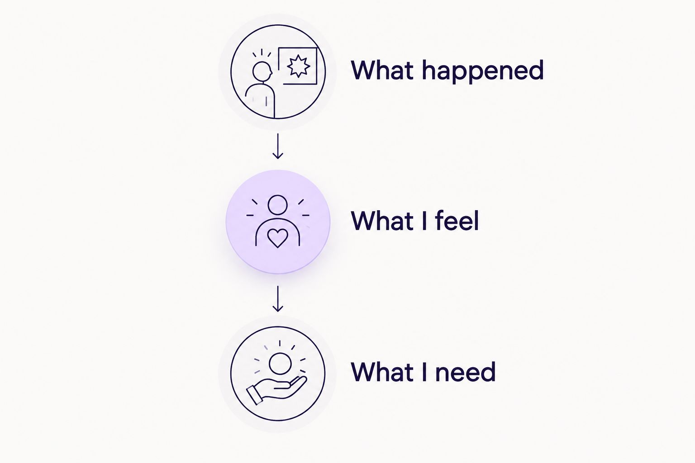

---
# Generated by import_ryze.py. Edit the source JSON in blog/data instead.
layout: "post"
title: "Healing journal for military spouses: complete 2026 guide"
seo_title: "Healing journal for military spouses: Start gently 2026"
description: "A healing journal for military spouses starts with room for you, not another routine. Find gentle prompts for deployment, motherhood, and changing plans."
date: "2026-11-03T20:38:19.726000+00:00"
last_modified: "2026-11-03T20:38:19.726000+00:00"
permalink: "/healing-journal-for-military-spouses-complete-guide/"
ryze_source: "blog/data/healing-journal-for-military-spouses-complete-guide.json"
category: "Real life"
category_key: "lifestyle"
edit_type: "The edit"
cover_note: "Healing journal for military spouses: complete 2026 guide"
read_time: "10 min read"
image: "/assets/images/ryze/healing-journal-for-military-spouses-complete-guide/featured.jpg"
image_alt: "Healing journal for military spouses: complete 2026 guide"
---

A healing journal for military spouses is a private space for reflection, with the aim of making room for your feelings alongside the demands of military family life. If you’re also raising children, that space can hold the part of your day that wasn’t about packing lunches, managing changes, or being the person who remembers everything.

TL;DR
<ul><li>A healing journal for military spouses supports personal reflection, not a promise of recovery or a substitute for care.</li><li>The Sheema Edit pairs personal essays with printable journals and planners for readers seeking reflection and flexible planning.</li><li>Start with one honest sentence about deployment, moving, motherhood, or something entirely unrelated to military life.</li><li>Keep self reflection separate from weekly planning when another task list is the last thing you need.</li></ul>

You don’t need to turn uncertainty into a lesson before you’re allowed to write about it. At <a href="https://thesheemaedit.com/" rel="noopener noreferrer">The Sheema Edit</a>, the focus is personal essays and printable journals and planners, not a standard you have to meet.

<strong>The Sheema Edit is best for readers who want personal reflection and printable planning resources, not clinical guidance.</strong> This 2026 guide offers a gentle starting point, whether you’re facing a separation, settling somewhere new, or simply wanting a little room to hear yourself think.

<h2>Why journaling matters for military spouses</h2>

Military life can put decisions outside your control while leaving plenty of everyday responsibility in your hands. A deployment, training period, or move can become the subject of every conversation, even when what you actually want to talk about is how lonely Tuesday felt.

A journal gives that smaller, personal story somewhere to go. You can love your family, respect your spouse’s work, and still dislike what a particular season asks of you. Those feelings don’t need to cancel each other out.

For mothers, there’s another distinction: the family’s schedule isn’t the same thing as your inner life. Remembering appointments tells you what needs doing. Writing that you miss having something of your own tells you something different.

Here, <em>healing journal</em> means a place for honest reflection. It doesn’t mean writing will treat a condition, resolve a relationship problem, or make a difficult season feel good. <strong>You’re allowed to use a journal without asking it to fix you.</strong>

<h2>Make room for reflection without creating another obligation</h2>

Think of these suggestions as doors, not assignments. Open whichever one fits; leave the others closed. Your 2026 journal doesn’t need a perfect opening page, and it certainly doesn’t need attendance requirements.

<h3>Choose a place that feels private enough</h3>

Start with something you already have: a notebook, loose paper stored somewhere suitable, or a personal document on a device you control. The first question isn’t whether it looks beautiful. It’s whether you can write honestly without worrying about who will read it.

Shared homes, visiting relatives, and children who investigate every drawer can make privacy a practical issue. Decide where your writing belongs before choosing what to put in it. Avoid recording sensitive work information or someone else’s private details.

<ul>
<li>Use a plain notebook if a decorative journal feels too precious to write in.</li>
<li>Check access settings before using a shared device or account.</li>
<li>Leave out identifying details you don’t need for your reflection.</li>
<li>Decide whether you want to keep, shred, or delete a particular entry.</li>
</ul>
<h3>Begin with the feeling, not the full explanation</h3>

You don’t have to document an entire deployment or explain the history of a disagreement. Start where you are. An optional 2 minute pause is enough space to try a sentence, but it isn’t a target you owe anyone.

If the page feels too open, finish this thought: <em>The part I haven’t said out loud is…</em> You can stop after the first sentence. You can also discover that you don’t want to write today; that’s useful information, not a failed attempt.

<ul>
<li>Name the feeling in your own words, even if the word is simply <em>done</em>.</li>
<li>Describe the moment that stayed with you instead of summarizing the whole day.</li>
<li>Write what you wish someone understood without composing a message to send.</li>
<li>Stop before you start polishing the entry for an imaginary audience.</li>
</ul>
<h3>Separate your feelings from your weekly plans</h3>

A blank page can hold both reflection and practical notes, but give them different spaces. Otherwise, <em>I miss feeling like myself</em> can disappear underneath <em>replace the missing lunch container</em>. Both deserve attention. They aren’t the same kind of need.

Try 3 lines headed <em>What happened</em>, <em>What I feel</em>, and <em>What I need</em>. The last line doesn’t have to become an action. Sometimes the answer is understanding, company, or permission to leave something unfinished.

<ul>
<li><strong>What happened:</strong> Describe the event without turning it into a verdict about yourself.</li>
<li><strong>What I feel:</strong> Name your response without adding what you should feel instead.</li>
<li><strong>What I need:</strong> Notice the need before deciding whether anything belongs on a calendar.</li>
</ul>

This layout keeps the event, your response, and your needs visible without requiring a long entry.

<figure><figcaption>A feeling can deserve space without becoming another task.</figcaption></figure>
If practical planning would genuinely help, use a separate sheet with room to move things around. The Sheema Edit offers printable journals and planners; start with paper you have, and consider a printable only if the format suits you. The guide to <a href="https://thesheemaedit.com/how-to-use-an-undated-weekly-planner" rel="noopener noreferrer">using an undated weekly planner</a> is a separate place to explore that approach without turning this reflection page into a schedule.

<h3>Match the prompt to the season you’re actually in</h3>

The same question won’t fit every stage of military life. Before a separation, you might want to name what you’re anticipating. During a move, you might want to acknowledge what you miss before anyone asks whether you’ve made friends yet.

Choose the prompt that feels closest, not the one that sounds most positive. You can also write about a book, a friendship, your work, or an ordinary pleasant afternoon. Being a military spouse doesn’t have to be the subject of every page.

<ul>
<li>Before a separation: <em>What do I want us to discuss while we have space to talk?</em></li>
<li>During time apart: <em>What am I carrying that other people don’t see?</em></li>
<li>During a move: <em>What am I allowed to miss without apologizing?</em></li>
<li>During reunion: <em>What feels familiar, and what feels different?</em></li>
<li>Outside the military story: <em>What has my attention because it belongs to me?</em></li>
</ul>
<h3>Make space for motherhood without disappearing into it</h3>

If you’re parenting through a separation or transition, your journal doesn’t have to become another record of how the children are doing. Their feelings matter. Yours don’t need to wait until everyone else has been accounted for.

Try keeping 1 page for thoughts that aren’t updates about the household. That doesn’t require a grand identity discovery. Wanting quiet, missing a friend, or being tired of deciding what everyone eats is enough material.

<ul>
<li>Finish: <em>Today I wanted something that had nothing to do with being useful.</em></li>
<li>Name an interest you’d like to keep close, even without a plan to pursue it.</li>
<li>Write about a kind of support you’d welcome rather than what you should manage alone.</li>
<li>Notice a good moment without making it proof that everything is fine.</li>
</ul>
<h3>Return without catching up</h3>

An undated journal has a useful advantage: the next page is still the next page. You don’t need to reconstruct the weeks when writing wasn’t possible or appealing. There’s no attendance office for this.

If you return later in 2026, begin with what feels current. Reading old entries is optional, too. Keep the parts of the practice that give you room; change the parts that make you feel watched or graded.

<ul>
<li>Start with <em>Today, the thing taking up space is…</em></li>
<li>Skip summaries unless remembering the missing weeks matters to you.</li>
<li>Change prompts when familiar questions start sounding like homework.</li>
<li>Close the notebook when you’ve said enough, even halfway down the page.</li>
</ul>
<h2>Choose the format that asks the least of you</h2>

<strong>Choose the format you can use honestly, not the one that looks most impressive.</strong> A guided journal offers direction, but its questions might not fit your day. Blank paper offers freedom, but deciding where to start can feel like another decision.

These options serve different purposes. None needs to become a daily routine, and none replaces personal or professional support when you need it.

<table>
<thead>
<tr>
<th>Option</th>
<th>Best for</th>
<th>What it offers</th>
<th>Key limitation</th>
</tr>
</thead>
<tbody><tr>
<td>Blank notebook</td>
<td>Spouses who want open space</td>
<td>Freedom to write, draw, or leave gaps</td>
<td>An empty page can feel difficult to begin</td>
</tr>
<tr>
<td>Prompted printable journal</td>
<td>Readers who want a starting question</td>
<td>A defined place to begin reflecting</td>
<td>Prompts won’t fit every situation; printing adds a step</td>
</tr>
<tr>
<td>Personal digital document</td>
<td>Readers who prefer typing</td>
<td>A place to write without carrying a notebook</td>
<td>Shared access and notifications need attention</td>
</tr>
<tr>
<td>Undated weekly planner</td>
<td>Mothers sorting practical responsibilities</td>
<td>Space to arrange tasks without fixed dates</td>
<td>A schedule doesn’t provide the same space as emotional reflection</td>
</tr>
</tbody></table>

For a 2026 starting point, use what you already own before choosing a different format. If a prompt helps, copy it onto your page. If a table or weekly grid feels like work, you don’t need to add one.

The Sheema Edit’s journals and planners sit alongside personal essays. That combination is for readers seeking both reflective content and planning resources; it isn’t a military spouse counseling service or a substitute for individualized care.

<h2>Common mistakes that make journaling feel heavier</h2>
<h3>Writing the version someone else would approve of</h3>

You don’t need to sound endlessly grateful, adaptable, or strong on a private page. Appreciation and frustration can sit in the same entry. Try writing the honest sentence first, before adding the explanation that makes it easier for someone else to hear.

<h3>Turning a deployment into a personal improvement assignment</h3>

Time apart doesn’t have to produce a transformed version of you. If you want to pursue something, let it be yours, not evidence that you used the separation correctly. Your journal can record an ordinary day without extracting a lesson.

<h3>Treating reunion as a required happy ending</h3>

A homecoming entry doesn’t have to sound like a celebration announcement. You can be glad someone is home and still have things to discuss. Write about your own experience without using the page to decide what everyone else must be feeling.

<h3>Making every feeling an action item</h3>

A lonely entry doesn’t automatically require a social calendar. A tired entry doesn’t require a better routine. Sometimes you’re naming an experience; sometimes you want a practical next move. Ask which kind of page you need before adding more to your week.

<h2>FAQ</h2>

What is a healing journal for military spouses?

A healing journal for military spouses is a place to reflect on your feelings and experiences around military family life. It can include separation, moving, motherhood, relationships, or subjects unrelated to the military. The term doesn’t mean the journal provides treatment.

What should I write during my spouse’s deployment?

Write about what feels present for you, such as something you miss, something you’re carrying, or something you wish someone understood. You don’t need to summarize the deployment or end each entry positively. Avoid including sensitive work information.

Do I need to journal every day?

No, you don’t need to journal every day. You can write when you want space to think and return after any length of break without catching up.

Is a guided journal better than a blank notebook?

A guided journal suits readers who want a starting question; a blank notebook suits readers who want more freedom. Either format has limits: prompts can feel irrelevant, while a blank page can leave you unsure where to begin.

Can I use a weekly planner as my journal?

Yes, you can use a weekly planner for reflection if you give feelings their own space. Keep practical tasks separate when combining them makes your private writing feel like another list of responsibilities.

What if journaling makes me feel worse?

Stop writing if the experience feels upsetting or overwhelming. You don’t owe the page a completed entry. If distress continues or you need support, reach out to a qualified mental health professional; a journal isn’t a replacement for care.

Does The Sheema Edit offer military spouse therapy?

The Sheema Edit is a personal blog with essays and a shop of printable journals and planners, not a therapy service. Its resources belong in personal reflection and planning, not in place of professional support.

<h2>One last thing</h2>

Leave a page for things you don’t want to turn into a project. A friendship you enjoy. A song you keep playing. A moment when nobody needed anything and you actually noticed the quiet.

Your 2026 journal can hold difficulty without becoming a permanent record of what hurts. You’re allowed to include something good without proving that everything else is okay first.

<h2>Related guides</h2>
<ul>
<li><a href="https://thesheemaedit.com/self-reflection-journal-prompts-for-moms" rel="noopener noreferrer">Self reflection journal prompts for moms</a></li>
<li><a href="https://thesheemaedit.com/self-reflection-journal-prompts-for-boundaries" rel="noopener noreferrer">Self reflection journal prompts for boundaries</a></li>
<li><a href="https://thesheemaedit.com/healing-journal-for-caregivers-complete-guide" rel="noopener noreferrer">Healing journal for caregivers</a></li>
</ul>

With Love, Sheema.

