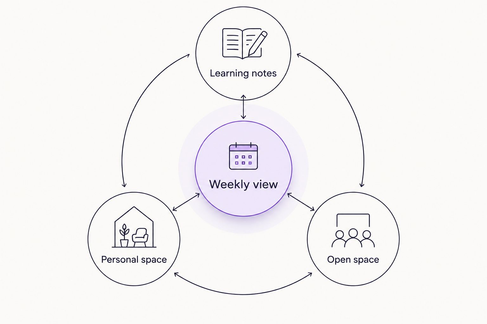

---
# Generated by import_ryze.py. Edit the source JSON in blog/data instead.
layout: "post"
title: "Mom planner for homeschool moms: complete 2026 guide"
seo_title: "Mom Planner for Homeschool Moms: Keep It Flexible 2026"
description: "Choose a mom planner for homeschool moms that leaves room for real life. Compare formats, plan a flexible week, and keep space for your own needs."
date: "2026-11-03T20:39:21.945000+00:00"
last_modified: "2026-11-03T20:39:21.945000+00:00"
permalink: "/mom-planner-for-homeschool-moms-complete-guide/"
ryze_source: "blog/data/mom-planner-for-homeschool-moms-complete-guide.json"
category: "Real life"
category_key: "lifestyle"
edit_type: "The edit"
cover_note: "Mom planner for homeschool moms: complete 2026 guide"
read_time: "9 min read"
image: "/assets/images/ryze/mom-planner-for-homeschool-moms-complete-guide/featured.jpg"
image_alt: "Mom planner for homeschool moms: complete 2026 guide"
---

A mom planner for homeschool moms is a place to bring learning plans, family commitments, and your own needs together so the week feels easier to see. This 2026 guide helps you choose a format without turning your home into a school office or giving yourself another assignment.

TL;DR
<ul><li>Choose a mom planner for homeschool moms around your actual week, not an ideal school day.</li><li>The Sheema Edit is best for moms seeking reflective essays alongside printable journals and planners.</li><li>Use undated weekly planning for flexibility, and keep required homeschool records separate when necessary.</li><li>Leave room for your needs; a full page isn&#x27;t proof of a good week.</li></ul>
<h2>Why a mom planner matters for homeschool moms</h2>

Homeschool planning holds more than lessons. A library visit shares space with groceries, an appointment interrupts a reading block, and someone still needs lunch. Possibly while you&#x27;re explaining fractions.

A useful planner lets you see those commitments together without pretending they all need the same amount of attention. It also leaves somewhere for you to exist as a person, not just the person remembering everything.

For your 2026 planning, start with the week you actually have. The guide to <a href="https://thesheemaedit.com/how-to-use-an-undated-weekly-planner" rel="noopener noreferrer">how to use an undated weekly planner</a> offers a related starting point if you&#x27;d rather add dates as you go.

<strong>Your planner should help you make choices, not grade your motherhood.</strong> A page that helps you decide what can wait has done something useful, even when several boxes stay empty.

<h2>Build a week with room to breathe</h2>

These steps are invitations, not a new routine to maintain. Try whichever one addresses the part of planning that currently feels tangled. You don&#x27;t need to finish the whole process before using a page.

<h3>Start with the life already on your calendar</h3>

Before adding lessons, write down the commitments that already shape your week. A notebook, spare sheet of paper, or existing calendar is enough for this first pass.

Include travel and preparation where they matter. An appointment isn&#x27;t only the appointment if getting everyone out the door takes a meaningful slice of the morning. You don&#x27;t need to predict every interruption; just stop asking the same stretch of time to do incompatible jobs.

Try a 10 minute planning window if a boundary helps. Stop when the main commitments are visible, even if the page isn&#x27;t pretty. The planner isn&#x27;t expecting company.

<ul>
<li>Add appointments, work commitments, and regular activities first.</li>
<li>Note which days involve leaving home or having visitors.</li>
<li>Mark space you want to leave unassigned.</li>
<li>Put errands together only when that genuinely makes the day easier.</li>
</ul>
<h3>Choose a small set of learning priorities</h3>

Start with what you want the week to hold rather than filling every day with a complete schedule. You can draft 3 weekly priorities on plain paper: perhaps continuing a reading book, practicing a math skill, and making space for a shared project.

These are examples, not a curriculum recommendation. Your children&#x27;s learning needs and any applicable homeschool requirements still shape what belongs in your plan.

Separate an intention from a clock time. Reading together belongs on the plan without necessarily belonging at an exact hour. If timing helps your household, use it; if it creates a daily argument with reality, try broader spaces such as morning or afternoon.

A 2026 planner doesn&#x27;t need every available box filled to be useful.

<ul>
<li>Write the learning priorities in ordinary language.</li>
<li>Distinguish necessary work from optional ideas.</li>
<li>Keep activities together when your children genuinely share them.</li>
<li>Leave unfinished plans open for reconsideration rather than automatic catch up.</li>
</ul>
<h3>Choose pages that ask less of you</h3>

Sketch your preferred layout before choosing a planner. Fold a sheet of paper, draw a weekly grid, or use an existing notebook. Notice what you actually reach for: a view of the whole week, somewhere to capture loose thoughts, or a place to write what happened.

The Sheema Edit offers printable journals and planners alongside personal essays. That makes the shop relevant when you&#x27;d rather begin with a prepared page than draw one yourself. Check the actual layout before choosing; a printable isn&#x27;t automatically a homeschool lesson planner or a recordkeeping system.

For 2026, choose pages you can imagine using during an ordinary, interrupted week. A beautiful layout that requires constant copying still requires constant copying.

<ul>
<li>Weekly view: somewhere to see commitments together.</li>
<li>Learning notes: somewhere to capture intentions or observations.</li>
<li>Personal space: somewhere for your own thoughts and needs.</li>
<li>Open space: somewhere that doesn&#x27;t arrive with an assignment.</li>
</ul>
<figure><figcaption>Your own needs belong beside the learning plans, not outside the page.</figcaption></figure><h3>Give yourself a place on the page</h3>

A planner can hold a thoughtful learning plan and still leave you out entirely. Before adding another tracking section, ask whether you have somewhere to name what you need.

That doesn&#x27;t require a long journal entry. Try 1 sentence: Today would feel gentler if I could ____. The answer might be practical, emotional, or wonderfully unremarkable. Eating lunch while it&#x27;s still lunch counts as something worth noticing.

The Sheema Edit&#x27;s emphasis on personal reflection fits here: the page can hold your experience, not just your responsibilities. For more optional starting points, use these <a href="https://thesheemaedit.com/self-reflection-journal-prompts-for-moms" rel="noopener noreferrer">self reflection journal prompts for moms</a>.

You don&#x27;t have to turn every feeling into an action item. Sometimes the useful part is admitting that something feels heavy without immediately organizing your way out of it.

<ul>
<li>Name something you&#x27;re carrying that isn&#x27;t visible on the calendar.</li>
<li>Write down a request you&#x27;d like to make.</li>
<li>Leave a little space for something you enjoy.</li>
<li>Skip the prompt when writing feels like more work.</li>
</ul>
<h3>Leave creative learning some breathing room</h3>

Once the main commitments are visible, look at where creative work would genuinely fit. Art doesn&#x27;t need to become the reward everyone earns only after the serious things are finished. It also doesn&#x27;t need an elaborate setup to justify its place.

When you <a href="https://www.thedesignelementary.com/post/how-to-plan-a-weekly-homeschool-art-and-design-routine" rel="noopener noreferrer">plan a weekly homeschool art routine</a>, include choosing materials and putting them away in the space you reserve. That makes the plan about the whole activity, not just the lovely middle when everyone is making something.

A simple invitation might be drawing something noticed on a walk or exploring materials you already have. Choose according to your children&#x27;s interests and what you can reasonably support that week. You don&#x27;t need a display worthy result for the activity to belong.

If the week changes, reconsider the plan rather than treating the unfinished project as a debt.

<ul>
<li>Choose an activity before gathering extra supplies.</li>
<li>Note anything that needs preparation or supervision.</li>
<li>Leave room for setup and clearing away.</li>
<li>Keep unfinished work only when returning to it still feels worthwhile.</li>
</ul>
<h3>Close the week without scoring yourself</h3>

A review can be a brief look back, not a performance meeting with yourself. Notice what happened before deciding what comes next. The lesson that changed direction, the question that became a conversation, and the afternoon you deliberately left quiet can all belong in that account.

Ask whether the plan was useful, not whether you obeyed it. Those are different questions. If you repeatedly ignore a section, consider removing it instead of promising to become a person who loves filling it in.

If you need formal attendance or learning records, maintain those according to the requirements that apply to you. A personal reflection page doesn&#x27;t replace them.

<ul>
<li>Record learning or moments you want to remember.</li>
<li>Identify a plan that asked too much of the available time.</li>
<li>Move unfinished work only if it still matters.</li>
<li>Leave yourself a kind, specific note for the next week.</li>
</ul>
<h2>Compare planner formats before choosing</h2>

<strong>The best format is the one that makes the week easier to understand without demanding constant upkeep.</strong> None of these options does every job. Choose according to what you need to see, who needs access, and how much structure you want already on the page.

<table>
<thead>
<tr>
<th>Option</th>
<th>Best for</th>
<th>What it offers</th>
<th>Key limitation</th>
</tr>
</thead>
<tbody><tr>
<td>Plain notebook</td>
<td>Moms testing what belongs in their plan</td>
<td>You decide the headings and amount of space</td>
<td>You create the layout yourself</td>
</tr>
<tr>
<td>Undated weekly printable</td>
<td>Moms who want a prepared weekly page without fixed dates</td>
<td>You add dates and print the pages you choose</td>
<td>Printing and keeping pages together require attention</td>
</tr>
<tr>
<td>Dated paper planner</td>
<td>Moms who prefer an existing calendar sequence</td>
<td>Dates are already assigned to pages</td>
<td>Unused dates remain part of the book</td>
</tr>
<tr>
<td>Shared digital calendar</td>
<td>Households coordinating appointments across adults</td>
<td>Shared visibility of scheduled commitments</td>
<td>A calendar alone doesn&#x27;t provide a personal reflection space</td>
</tr>
</tbody></table>

You don&#x27;t have to choose one format for every purpose. A shared calendar can hold appointments while paper holds thoughts. The limitation is duplicate work: copying the same commitment into several places creates several places to update.

Before committing to a 2026 format, try your proposed layout during an ordinary week. Notice what you use and what you avoid. That tells you more than imagining the version of yourself who writes neatly every Sunday evening.

<h2>Common planner mistakes homeschool moms can skip</h2>
<h3>Treating the planner like a classroom timetable</h3>

A timetable can be useful when timing matters. The problem starts when every home activity receives an exact start time that your household doesn&#x27;t need. Use fixed times for actual commitments and leave other plans less tightly assigned.

<h3>Confusing a personal planner with required records</h3>

A family planning page and a homeschool record serve different purposes. Check your applicable requirements before assuming a weekly spread covers them. Keep the information you need without asking your personal journal to become an administrative file.

<h3>Making missed pages into catch up work</h3>

An unused page doesn&#x27;t need an explanation. With an undated format, you can add the current dates and begin again. With a dated format, you can turn to the current week without completing the weeks behind it.

<h3>Tracking everyone except yourself</h3>

If the page holds every child&#x27;s activity but nothing about your needs, change the page. Your notes don&#x27;t have to be impressive or useful to someone else. You belong in the week you&#x27;re planning.

<h2>FAQ</h2>

What&#x27;s the best mom planner for homeschool moms?

The best mom planner for homeschool moms fits your actual commitments and leaves room for your own needs. An undated weekly format suits readers who want to add dates as they go, while a dated planner suits readers who prefer an existing calendar sequence.

Can I use a regular weekly planner for homeschooling?

Yes, you can use a regular weekly planner to organize learning intentions, appointments, and household commitments. Keep any required homeschool records separately if the planner doesn&#x27;t capture the information you need.

How do I plan homeschool days without an hourly schedule?

Write weekly learning priorities and place them around fixed commitments. Use broad parts of the day when helpful, and reserve exact times for activities that actually require them.

Do I need a separate planner for each child?

You don&#x27;t need a separate planner for each child to make a family overview. Start with a shared page and add separate notes only where different learning plans or recordkeeping needs make them useful.

What should I do when we don&#x27;t finish the weekly plan?

Reconsider unfinished work before moving it into the next week. Keep what still matters, change what no longer fits, and don&#x27;t treat every unused plan as something you owe.

Can a homeschool planner include journaling?

Yes, a homeschool planner can include space for your thoughts alongside learning plans. A brief note about what you need or what felt meaningful is enough; daily writing isn&#x27;t required.

Does The Sheema Edit offer a dedicated homeschool planner?

The Sheema Edit offers printable journals and planners, but a dedicated homeschool planner isn&#x27;t established here. Review the current product details for the layout and purpose rather than assuming it includes lesson planning or required records.

<h2>One last thing</h2>

Before adding another section, try deleting one you never use. A smaller planning page can be a deliberate choice, not evidence that you&#x27;ve given up on being organized.

<strong>Leave yourself room to be a person inside the week.</strong> The meals, lessons, appointments, and laundry already have a way of making themselves known. Your needs deserve somewhere to land, too.

<h2>Related guides</h2>
<ul>
<li><a href="https://thesheemaedit.com/choose-undated-weekly-planner" rel="noopener noreferrer">Choosing an undated weekly planner</a></li>
<li><a href="https://thesheemaedit.com/best-printable-weekly-planners-for-busy-moms" rel="noopener noreferrer">Printable weekly planners for busy moms</a></li>
<li><a href="https://thesheemaedit.com/best-undated-planners-for-self-care-routines" rel="noopener noreferrer">Undated planners for self care routines</a></li>
</ul>

