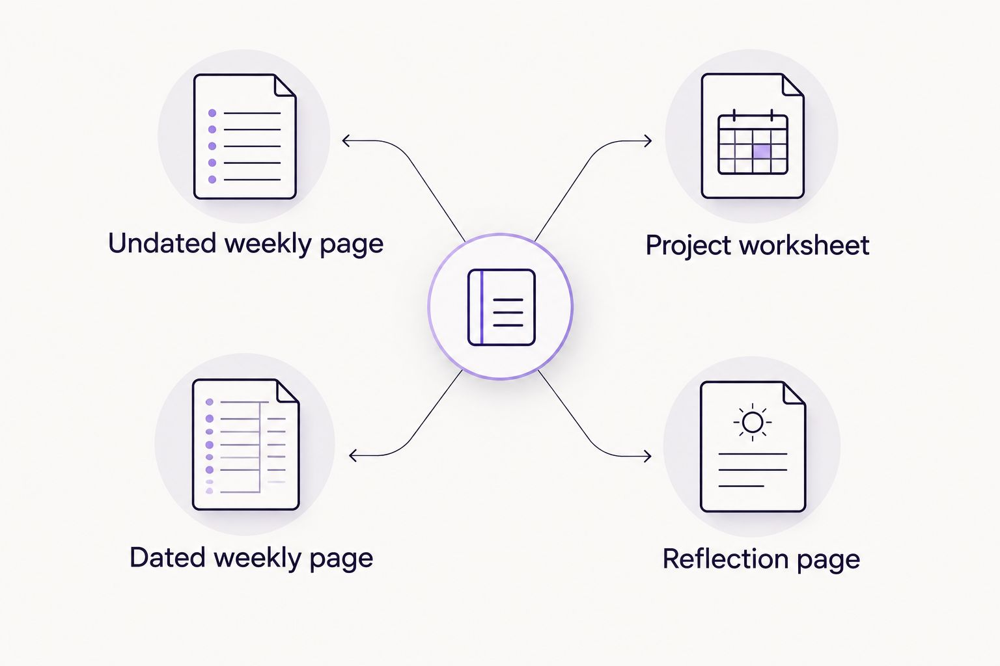

---
# Generated by import_ryze.py. Edit the source JSON in blog/data instead.
layout: "post"
title: "Printable planner for freelancers: complete 2026 guide"
seo_title: "Printable Planner for Freelancers: Choose Undated 2026"
description: "Choose a printable planner for freelancers that leaves room for client deadlines, motherhood, and rest, with gentle prompts and flexible weekly planning."
date: "2026-11-04T20:03:05.815000+00:00"
last_modified: "2026-11-04T20:03:05.815000+00:00"
permalink: "/printable-planner-for-freelancers-complete-guide/"
ryze_source: "blog/data/printable-planner-for-freelancers-complete-guide.json"
category: "Real life"
category_key: "lifestyle"
edit_type: "The edit"
cover_note: "Printable planner for freelancers: complete 2026 guide"
read_time: "10 min read"
image: "/assets/images/ryze/printable-planner-for-freelancers-complete-guide/featured.jpg"
image_alt: "Printable planner for freelancers: complete 2026 guide"
---

A printable planner for freelancers is a paper workspace for organizing client commitments, personal needs, and work boundaries so you can see what fits before saying yes. This guide focuses on flexible weekly planning for freelancers who are also moms, where a deadline and a school pickup can both be nonnegotiable.

TL;DR
<ul><li>Choose an undated printable planner for freelancers when your workload changes between weeks.</li><li>Keep client deadlines visible without turning every open hour into working time.</li><li>The Sheema Edit suits readers seeking printable journals, planners, and thoughtful essays rather than project management software.</li><li>Pair weekly planning with optional self reflection, not another daily obligation.</li></ul>
<h2>Why printable planning matters for freelance moms</h2>

Freelance work asks you to hold several kinds of responsibility at once. You deliver the work, answer the messages, remember the invoice, and decide whether another assignment belongs in an already crowded week.

Motherhood doesn&#x27;t politely wait outside that arrangement. A school event belongs on the calendar just as much as a client call, even when only one comes with a meeting invitation.

<strong>Your planner should show your actual capacity, not the version of your life where nobody needs anything.</strong> For your 2026 setup, that means choosing a page you can leave partly empty, change, or return to after a difficult week.

<a href="https://thesheemaedit.com/" rel="noopener noreferrer">The Sheema Edit</a> is best for readers who want printable journals and planners alongside thoughtful essays, not project management software. That combination makes room for both the practical question, what needs doing, and the quieter one, what do you need?

Paper still has limits. It won&#x27;t send a reminder, update a client, or keep your accounting records for you. Give it a clear job: helping you decide what belongs in the week.

<h2>Build a week you can actually live inside</h2>

You don&#x27;t need a new purchase to try this approach. A blank sheet and whatever pen hasn&#x27;t disappeared into the household pen dimension will do.

The following steps are options, not a routine you have to complete every Sunday. Use the pieces that make your week clearer and leave the rest alone.

<h3>Start with the commitments that already exist</h3>

Before writing a task list, mark the parts of your week that are already spoken for. Include client meetings, appointments, school commitments, and time when you&#x27;re responsible for care.

This isn&#x27;t about treating your family like an obstacle to work. It&#x27;s about refusing to build a work plan on hours you don&#x27;t actually have.

Try making 3 headings on plain paper: fixed commitments, flexible work, and personal needs. Sort what you remember into those spaces before assigning anything to a day. The headings are a starting point, not a new filing system to maintain.

If the page fills up before you add client tasks, that&#x27;s useful information. You haven&#x27;t failed at planning; you&#x27;ve found a crowded week before promising more of it away.

<ul>
<li>Mark appointments and agreed client calls first.</li>
<li>Include preparation or travel where it applies.</li>
<li>Write down caregiving responsibilities that affect work time.</li>
<li>Leave genuinely unclaimed space unclaimed.</li>
</ul>
<h3>Choose a layout that matches this season</h3>

Draw a simple weekly page before shopping for one. Give each day enough space for a few notes, then add a separate area for tasks that don&#x27;t need a particular date.

An undated layout lets you write the dates when you use it. If you skip a week, you can start on the next blank page without filling in what you missed. A dated layout has its own advantage: the calendar is already there.

For a 2026 planner, choose based on the weeks you&#x27;re living, not the beautifully imaginary ones. If you want a practical walkthrough, this guide to <a href="https://thesheemaedit.com/how-to-use-an-undated-weekly-planner" rel="noopener noreferrer">how to use an undated weekly planner</a> explains the basic approach.

The Sheema Edit offers printable journals and planners if you&#x27;d rather begin with a prepared page. Check each item&#x27;s description before choosing; don&#x27;t assume every printable includes freelance project sections or business records.

<ul>
<li>Look for writing space you can comfortably use.</li>
<li>Decide whether you prefer dates already printed.</li>
<li>Check the stated printing instructions before printing.</li>
<li>Skip sections you&#x27;d only fill out from obligation.</li>
</ul>
<h3>Separate deadlines from the work before them</h3>

A deadline tells you when something is due. It doesn&#x27;t explain what needs to happen before you can send it.

On plain paper, write the deliverable first, then name the next visible action. For example, preparing an article might involve reviewing the brief, drafting the opening, and checking requested revisions. Use only the actions that belong to your work.

If you&#x27;re managing 2 client projects, give each a short, recognizable label. Keep the full instructions somewhere reliable rather than squeezing an entire brief into a tiny Wednesday box.

You can also distinguish a promised deadline from a date you&#x27;ve chosen for yourself. Both matter, but they carry different consequences when the week changes. Knowing which is which helps you decide what to move without treating every unfinished note as an emergency.

<ul>
<li>Write the agreed delivery date clearly.</li>
<li>Name the next action in ordinary language.</li>
<li>Mark anything waiting on client information.</li>
<li>Keep detailed briefs separate from the weekly page.</li>
</ul>
<h3>Give work a stopping point</h3>

An open afternoon isn&#x27;t automatically an invitation to work until dinner. Decide what would count as enough for the time you have, even if there&#x27;s more you could do.

Start with a short task description rather than a vague promise to catch up. Send the revised draft is clearer than get ahead. Neither phrase requires you to become a different person before lunchtime.

If a timer helps, try a 15 minute planning pause to sort the next piece of work. That&#x27;s an optional boundary for the exercise, not a claim about how long planning should take.

For your 2026 weekly pages, include a place to notice what you&#x27;re choosing not to take on. A visible limit can be more useful than another box to tick, particularly when a new request arrives wrapped in the word quick.

<ul>
<li>Choose a clear stopping point for a work session.</li>
<li>Leave space between commitments where you need it.</li>
<li>Write down requests before agreeing to them.</li>
<li>Keep a separate list for work that isn&#x27;t this week&#x27;s responsibility.</li>
</ul>
<h3>Make room for a sentence about yourself</h3>

Your planner can hold more than evidence that you were useful. A small reflection space gives you somewhere to name your experience without turning it into another assignment.

Start on the back of the page. Ask yourself what feels heavy, what helped, or what you wish someone understood about the week. A few honest words count; so does deciding you&#x27;d rather not write today.

The Sheema Edit&#x27;s printable journals are another place to explore self reflection if a separate page feels more comfortable. You don&#x27;t need a journal and a planner, though. One sheet can hold both, and a private thought doesn&#x27;t need to become an action item.

Keep reflection optional, especially when you&#x27;re tired. The point isn&#x27;t to extract a lesson from every hard day. Sometimes the most accurate sentence is that today asked a lot of you.

<ul>
<li>Try the prompt: What needs less pressure this week?</li>
<li>Name something you enjoyed without making it a reward.</li>
<li>Notice a boundary you want to keep.</li>
<li>Leave the space blank when writing feels like more work.</li>
</ul>
<h3>Adjust the page instead of judging the week</h3>

When plans change, begin with what&#x27;s still true. Which deadline remains? Which task no longer matters? What needs a conversation rather than another arrow to tomorrow?

You can review your page whenever it becomes useful again. There&#x27;s no requirement to finish a weekly review before starting a new week, and no need to reconstruct days you didn&#x27;t record.

Before carrying a task forward, decide whether it still deserves space. Repeatedly copying the same task can hide a different problem: unclear instructions, an unnecessary commitment, or work you need to renegotiate.

Keep your 2026 pages useful by letting them change. A crossed out plan isn&#x27;t a damaged planner. It&#x27;s a record that your circumstances changed and you responded, which is considerably more realistic than pretending Tuesday followed the script.

<ul>
<li>Keep tasks that still have a clear purpose.</li>
<li>Remove work that no longer belongs to you.</li>
<li>Contact the client when a commitment needs discussing.</li>
<li>Start a fresh page without completing the old one.</li>
</ul>
<h2>Compare printable planning options</h2>

<strong>The best format is the one that answers your immediate planning question without demanding extra upkeep.</strong> You can sketch any of these layouts on paper before deciding whether a prepared printable would help.

These are format choices, not claims about features in a particular shop. For 2026, compare the structure first; decorative details won&#x27;t tell you whether there&#x27;s room for your actual handwriting.

<table>
<thead>
<tr>
<th>Option</th>
<th>Best for</th>
<th>Main advantage</th>
<th>Key limitation</th>
</tr>
</thead>
<tbody><tr>
<td>Undated weekly page</td>
<td>Freelancers whose workload varies between weeks</td>
<td>Lets you begin with the week you&#x27;re in</td>
<td>You need to add dates and maintain your own reminders</td>
</tr>
<tr>
<td>Dated weekly page</td>
<td>Freelancers who prefer a calendar already in place</td>
<td>Keeps dates visible without writing them in</td>
<td>Unused weeks remain tied to their printed dates</td>
</tr>
<tr>
<td>Project worksheet</td>
<td>Freelancers handling several stages of a deliverable</td>
<td>Separates project details from the weekly view</td>
<td>Doesn&#x27;t show your whole week on its own</td>
</tr>
<tr>
<td>Reflection page</td>
<td>Freelancers wanting space for personal check ins</td>
<td>Gives feelings and needs somewhere to land</td>
<td>Doesn&#x27;t replace deadline tracking or business records</td>
</tr>
</tbody></table>

A weekly page and a project worksheet can work together, but that doesn&#x27;t mean you need both. Add a page only when you can name the problem it solves.

<figure><figcaption>Choose a page for the question you need answered, rather than collecting every format.</figcaption></figure><h2>Common mistakes that make freelance planning feel heavier</h2>

A planner can become another place to feel behind if the rules around it are too demanding. Watch for these specific traps, especially when paid work and family responsibilities share the same week.

<h3>Scheduling paid work into every available gap</h3>

A gap between appointments isn&#x27;t necessarily enough space to begin a demanding task. You still need room to eat, change gears, and be a person. <strong>Leave some space without assigning it a purpose.</strong>

<h3>Putting business records only on paper</h3>

A note saying invoice sent doesn&#x27;t replace the invoice or its payment record. Let your planner remind you to handle administration while keeping the actual documents in a reliable system.

<h3>Copying someone else&#x27;s ideal workday</h3>

A schedule built around uninterrupted mornings won&#x27;t help if your mornings involve school preparation or care. Begin with your own commitments rather than treating someone else&#x27;s routine as the standard.

<h3>Turning reflection into a performance review</h3>

You don&#x27;t need to finish a hard week by explaining how you&#x27;ll do better. Try asking what support or adjustment would make the next week more manageable instead.

<h2>FAQ</h2>

What&#x27;s the best printable planner for freelancers who are also moms?

An undated weekly page is a useful starting point when work and family commitments change between weeks. Look for enough writing space and a layout that separates fixed commitments from flexible tasks.

Is an undated planner better than a dated planner for freelance work?

An undated planner is better suited to starting and stopping without unused dated pages. A dated planner suits readers who prefer the calendar already printed; neither format manages reminders for you.

Can I use a printable planner without planning every day?

Yes, you can use a printable planner only when it helps. Write a weekly overview, return before a deadline, or start again after a gap without filling in missed days.

What should I write in a freelance weekly planner?

Write your fixed commitments, agreed deadlines, and next actions first. Add personal needs or an optional reflection prompt if you want them on the same page.

Can a paper planner replace project management software?

A paper planner can hold your personal overview, but it doesn&#x27;t provide automatic reminders or shared project updates. Keep any systems your client work requires and give the paper page a separate, clear purpose.

What if I keep moving the same task to next week?

Check whether the task still matters before copying it again. It might need a clearer next action, information from someone else, or a conversation about the commitment.

Do I need a separate journal and planner?

No, a single page can hold planning notes and a little self reflection. Separate them only if you prefer more privacy, more writing space, or a clearer distinction between work and personal thoughts.

<h2>One last thing</h2>

Before printing a whole stack, try one page during an ordinary week. Notice where you run out of room, which section you ignore, and whether the page helps you make a decision.

<strong>An unused section isn&#x27;t a character flaw; it&#x27;s information about the layout.</strong> You can cross it out, rename it, or choose something simpler. Your life doesn&#x27;t owe the printable a completed form.

<h2>Related guides</h2>
<ul>
<li><a href="https://thesheemaedit.com/choose-undated-weekly-planner" rel="noopener noreferrer">Choose an undated weekly planner</a></li>
<li><a href="https://thesheemaedit.com/self-reflection-journal-prompts-for-boundaries" rel="noopener noreferrer">Self reflection journal prompts for boundaries</a></li>
<li><a href="https://thesheemaedit.com/undated-weekly-planner-for-working-moms" rel="noopener noreferrer">An undated weekly planner for working moms</a></li>
</ul>

