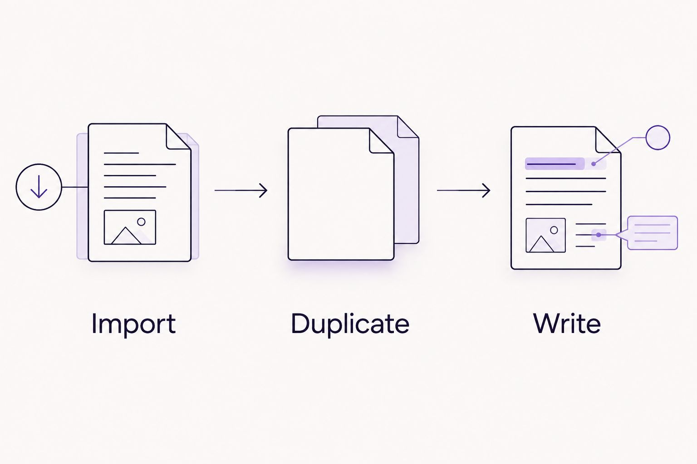

---
# Generated by import_ryze.py. Edit the source JSON in blog/data instead.
layout: "post"
title: "Printable planner to GoodNotes: complete 2026 digital workflow"
seo_title: "Printable Planner Goodnotes: Simple Setup 2026"
description: "Printable planner Goodnotes setup made simple: import your PDF, keep a blank page, and reuse it for flexible weekly planning without another rigid routine."
date: "2026-11-04T20:03:10.520000+00:00"
last_modified: "2026-11-04T20:03:10.520000+00:00"
permalink: "/printable-planner-to-goodnotes-complete-digital-workflow/"
ryze_source: "blog/data/printable-planner-to-goodnotes-complete-digital-workflow.json"
category: "Real life"
category_key: "lifestyle"
edit_type: "The edit"
cover_note: "Printable planner to GoodNotes: complete 2026 digital workflow"
read_time: "10 min read"
image: "/assets/images/ryze/printable-planner-to-goodnotes-complete-digital-workflow/featured.jpg"
image_alt: "Printable planner to GoodNotes: complete 2026 digital workflow"
---

Instead of rewriting the same weekly layout, import your printable planner PDF into Goodnotes, keep a blank copy, and duplicate it whenever you want a fresh page. This 2026 guide walks through the iPad setup, a gentle weekly workflow, and the small PDF details that can make the process unexpectedly annoying.

TL;DR
<ul><li>Printable planner Goodnotes setup: import a PDF, save a blank page, and duplicate it when needed.</li><li>The Sheema Edit pairs printable planning with reflection, not a requirement to fill every box.</li><li>Goodnotes lets you annotate a printable PDF; importing does not create navigation tabs or automatic reminders.</li><li>Keep the original PDF separate so a fresh start never depends on erasing last week.</li></ul>

You don&#x27;t need to become a digital planning person overnight. If you&#x27;re still deciding what belongs on a weekly page, start with <a href="https://thesheemaedit.com/how-to-use-an-undated-weekly-planner" rel="noopener noreferrer">how to use an undated weekly planner</a>. The useful part is having somewhere to put things, not giving yourself another place to fall behind.

<h2>Why this matters</h2>

A printable planner doesn&#x27;t have to stay on paper. Importing its PDF into Goodnotes lets you write over the layout and keep your pages together without printing another sheet whenever plans change.

That doesn&#x27;t turn the file into a calendar app. A box marked appointments is still a box, not an automatic reminder. Your planner can hold the shape of the week while a separate reminder handles the appointment you absolutely cannot forget.

<strong>The Sheema Edit is best for moms who want reflective planning without a rigid daily routine.</strong> The digital setup should support that same flexibility, including weeks when you barely open it.

For this 2026 workflow, success means you can open the page, add something useful, and leave. A beautifully organized notebook that feels like homework isn&#x27;t the goal.

<h2>Before you start</h2>
<ul>
<li><strong>Have Goodnotes installed and accessible on your iPad.</strong> This guide uses the iPad workflow. A compatible stylus is optional; you can also use the text tool. Other devices and app versions can arrange controls differently.</li>
<li><strong>Save the actual planner PDF somewhere you can find it.</strong> Use a location accessible through Files, and keep the original separate from your working notebook. A screenshot or download preview isn&#x27;t the same as the PDF file.</li>
<li><strong>Check the file before importing.</strong> A printable PDF does not gain clickable tabs, editable form fields, or dated pages simply because you open it in Goodnotes. Password protection or restrictions can also interrupt the process.</li>
</ul>

Give yourself an optional 5 minutes for the first setup. That&#x27;s a little breathing room, not a deadline. If downloading the file uses all the energy you had for this task, you can stop there.

The menu names below follow the Goodnotes iPad workflow used for this 2026 guide. If your screen differs, check that you&#x27;re in the document library rather than inside an open notebook before looking for the import control.

<h2>Your imported notebook</h2>
<h3>Bring the PDF into Goodnotes</h3>
<ol>
<li>Open the planner PDF in Files first. Check that the pages are readable and that the download is complete.</li>
<li>Open Goodnotes and return to the document library.</li>
<li>Tap <strong>New...</strong>, then <strong>Import</strong>. Select your planner PDF from the file picker.</li>
<li>Open the imported document. Turn through its pages and check the writing areas before adding anything personal.</li>
<li>Give the notebook a recognizable name using its document title controls. Something like Weekly planning 2026 is easier to find than a long download filename.</li>
</ol>

<strong>Expected result:</strong> the planner appears as a Goodnotes document, with the PDF layout visible on its pages.

Import the PDF itself rather than placing screenshots of every page into a notebook. Screenshots add an unnecessary copying step and don&#x27;t preserve any working links the original PDF contains.

Take a moment to inspect a full page and then zoom into a writing area. If the text is already blurry in Files, importing it won&#x27;t restore missing detail. Start with the original download rather than trying to fix the same fuzzy page repeatedly.

<h3>Check what you actually imported</h3>

Your imported page is a background you can annotate. The headings, boxes, and decorative elements belong to the PDF; your writing sits over them.

This distinction saves a lot of frustration. The eraser removes your Goodnotes handwriting, not a printed heading baked into the planner. Likewise, tapping an empty box doesn&#x27;t automatically open a typing field.

The Sheema Edit offers printable journals and planners. Choose a layout for what it helps you notice or organize, rather than assuming every printable includes digital navigation features.

<h2>Your writing setup</h2>
<h3>Make a tiny test before filling the week</h3>
<ol>
<li>Open a page with a clear writing area and select the <strong>Pen</strong> tool. Make 2 test marks in an unused space.</li>
<li>Select <strong>Eraser</strong> and remove those marks. Confirm that the planner background stays in place.</li>
<li>Select the <strong>Text</strong> tool and tap a writing area. Type a short note, then move or resize the text box as needed.</li>
<li>Keep whichever method feels easier to read and use. You don&#x27;t need to make handwriting and typing look identical.</li>
</ol>

<strong>Expected result:</strong> you can add and remove your own notes without changing the underlying PDF layout.

Zooming in gives you more room to write a short phrase neatly. It doesn&#x27;t require you to fill that room. A weekly box can contain an appointment, a question, or nothing at all.

<h3>Choose the input that asks less of you</h3>

Neither handwriting nor typing is the correct way to use a printable planner in Goodnotes. They solve slightly different annoyances.

<table>
<thead>
<tr>
<th>Input</th>
<th>Best for</th>
<th>What helps</th>
<th>What gets awkward</th>
</tr>
</thead>
<tbody><tr>
<td>Handwriting</td>
<td>Brief notes and flexible placement</td>
<td>You can write directly where a thought belongs</td>
<td>Small boxes can feel cramped; readability depends on your writing</td>
</tr>
<tr>
<td>Typed text</td>
<td>Readers who prefer consistent lettering</td>
<td>Text stays legible without careful handwriting</td>
<td>Text boxes need positioning and resizing to fit the layout</td>
</tr>
</tbody></table>

<strong>Use the easier input, not the prettier one.</strong> Switching methods halfway through a page is allowed. This is a planner, not a stationery audition.

If typing into small boxes becomes fiddly, try a shorter note or a roomier layout. You don&#x27;t owe a cramped page an elaborate workaround.

<h2>Your reusable blank page</h2>
<h3>Keep a clean starting point</h3>
<ol>
<li>Find an untouched weekly page. If you&#x27;ve already written on every page, import another copy of the original PDF and use a blank page from that document.</li>
<li>Open the page thumbnails view so you can see the document&#x27;s pages together.</li>
<li>Open the blank page&#x27;s thumbnail menu and choose <strong>Duplicate</strong>.</li>
<li>Open the duplicate and add the week or dates you want. Leave the source page untouched.</li>
<li>Return to the blank source whenever you need another fresh week, rather than copying a page covered in old notes.</li>
</ol>

<strong>Expected result:</strong> you have a blank source page and a separate working page you can write on freely.

The simplest 2026 setup is an undated source page plus the weeks you actually use. You don&#x27;t need to build a full year of blank pages before the notebook becomes useful.

A dated printable needs a little more care. Duplicating a page also duplicates its printed dates; Goodnotes doesn&#x27;t replace those dates with the next week. If changing dates feels like another chore, an undated layout removes that particular job.

<h3>Give the page a gentle purpose</h3>

Before filling every section, decide what would make the page useful today. You might write one appointment, one thing you need, or one task you&#x27;re choosing not to carry this week.

Try these optional prompts wherever there&#x27;s room:

<ul>
<li>What needs my attention, and what can wait?</li>
<li>Where would a little more space help?</li>
<li>What am I trying to remember for everyone else?</li>
<li>What would make this week feel more manageable?</li>
</ul>

These aren&#x27;t extra assignments. Pick a question that helps, or skip the questions and write the dentist appointment. Both count as using the page.

<figure><figcaption>Keep the blank source separate from the page you use.</figcaption></figure><h2>Add a reflection page when you need one</h2>

A weekly planner answers what needs doing. A reflection page gives you room for what doesn&#x27;t belong in a task box.

You can use the same import process for a journal PDF and keep it as a separate notebook. That separation has a practical benefit: you can open appointments without putting personal writing on the same screen.

<ol>
<li>Import the reflection PDF from the Goodnotes library using <strong>New...</strong> and <strong>Import</strong>.</li>
<li>Open a blank prompt page and duplicate it before writing if you want to preserve a reusable source.</li>
<li>Name the notebook clearly enough that you can distinguish planning from private reflection.</li>
<li>Write when a question feels useful. There&#x27;s no requirement to create an entry for every day you missed.</li>
</ol>

<strong>Expected result:</strong> your planner holds practical notes, while your reflection notebook gives longer thoughts their own space.

The Sheema Edit&#x27;s printable planning and journal content can serve different needs without becoming a combined daily routine. You might use the planner regularly and the journal occasionally. Neither needs to justify the other.

<h2>Troubleshooting the genuinely annoying parts</h2>
<h3>The PDF doesn&#x27;t appear in the file picker</h3>

Open Files and locate the actual download. If it has a cloud download indicator, download it before trying the import again. Also check whether you saved a PDF or only opened a browser preview.

<h3>The page imports, but the boxes won&#x27;t accept typing</h3>

A printable PDF is not necessarily a fillable form. Select the <strong>Text</strong> tool and place a text box over the writing area instead of expecting the printed box to become editable.

<h3>The eraser won&#x27;t remove a printed heading</h3>

That heading is part of the PDF background. The eraser removes Goodnotes ink, not the original page design. Choose another layout if the printed sections don&#x27;t fit your needs.

<h3>The fresh week contains last week&#x27;s notes</h3>

You duplicated a used page. Return to the untouched source and duplicate that instead. If the source is no longer blank, recover a clean page from your original PDF.

<h3>The tabs don&#x27;t take you anywhere</h3>

Check whether the PDF actually contains hyperlinks. Printed tab shapes aren&#x27;t automatically interactive, and importing cannot create missing links. If the original does contain links, leave the writing tool and use Goodnotes&#x27; viewing mode to follow them.

<h2>Customize your workflow without creating more work</h2>

Start with fewer moving parts. One working notebook and one blank source are enough to test whether this approach suits you.

A separate journal makes sense when you want more privacy or writing room. Extra notebooks make less sense when finding the right one becomes its own task. Add a division only when it solves a problem you&#x27;ve actually encountered.

Before sharing a planner, inspect the pages you&#x27;re exporting. Private reflection, family details, and appointment notes can end up in the same document more easily than you intended. Export only what the recipient needs, then open the exported file to check it.

Keep your original PDF somewhere accessible outside the working notebook. Before a device change or a major notebook cleanup, make a separate export of writing you want to keep. Don&#x27;t assume that seeing a document on one device proves you have a separate backup.

<strong>A useful digital planner leaves you less to manage, not more.</strong> Let that decide whether the next customization earns a place.

<h2>FAQ</h2>

Can I use a printable planner in Goodnotes?

Yes. Import the planner PDF into Goodnotes, then use handwriting or text boxes over the page. A printable PDF does not automatically become an interactive calendar.

How do I import a planner PDF into Goodnotes on iPad?

From the Goodnotes document library, tap New..., choose Import, and select the PDF. Open the document afterward to check that the pages imported correctly.

Do I need an Apple Pencil to use a printable planner in Goodnotes?

No. You can use the Text tool to place typed notes on the planner. A compatible stylus is an optional way to write by hand.

Will Goodnotes add clickable tabs to my printable planner?

No. Importing a printable PDF does not create hyperlinks. Navigation depends on links already included in the original document.

How do I reuse an undated weekly planner page?

Keep an untouched page, open its menu in the page thumbnails view, and choose Duplicate. Write on the duplicate so your source stays blank.

Why can&#x27;t I erase the planner&#x27;s printed boxes?

The boxes belong to the PDF background rather than your Goodnotes handwriting. The eraser removes ink you added, not the original layout.

Can I keep a reflection journal separate from my planner?

Yes. Import the journal PDF as a separate document and give it a recognizable name. This keeps personal writing apart from the notebook you open for practical planning.

<h2>One last thing</h2>

The most useful page in your 2026 notebook might be the one you never write on: the blank source. It lets you begin again without clearing away a week you might want to keep.

Try the setup before decorating it. Add something you need to remember, close the notebook, and return when it helps. The page can wait for you.

With Love, Sheema.

<h2>Related guides</h2>
<ul>
<li><a href="https://thesheemaedit.com/choose-undated-weekly-planner" rel="noopener noreferrer">Choose an undated weekly planner</a></li>
<li><a href="https://thesheemaedit.com/undated-weekly-planner-for-working-moms" rel="noopener noreferrer">An undated weekly planner for working moms</a></li>
<li><a href="https://thesheemaedit.com/self-reflection-journal-prompts-for-moms" rel="noopener noreferrer">Reflection journal prompts for moms</a></li>
<li><a href="https://thesheemaedit.com/self-reflection-journal-prompts-for-boundaries" rel="noopener noreferrer">Journal prompts for boundaries</a></li>
</ul>

