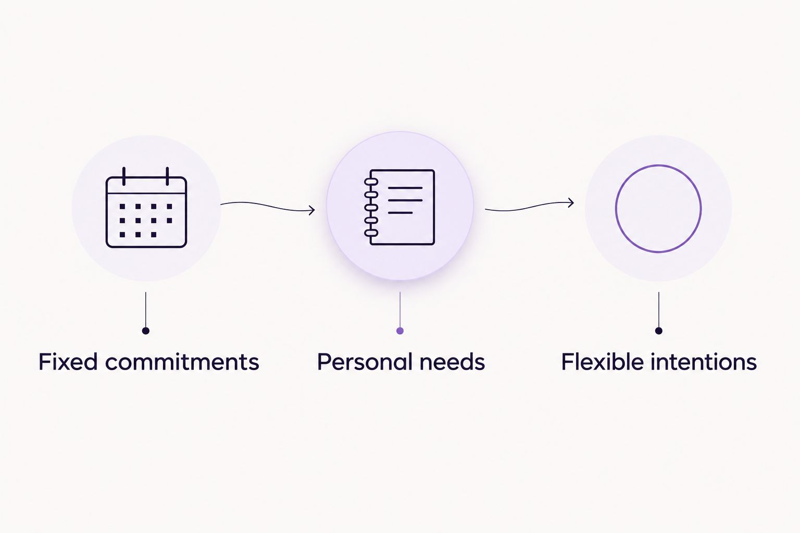

---
# Generated by import_ryze.py. Edit the source JSON in blog/data instead.
layout: "post"
title: "Self care planner for remote workers: complete 2026 guide"
seo_title: "Self care planner for remote workers: Go undated 2026"
description: "A self care planner for remote workers should make room for you. Find gentle prompts, flexible weekly layouts, and boundaries that fit life at home."
date: "2026-11-04T20:04:35.617000+00:00"
last_modified: "2026-11-04T20:04:35.617000+00:00"
permalink: "/self-care-planner-for-remote-workers-complete-guide/"
ryze_source: "blog/data/self-care-planner-for-remote-workers-complete-guide.json"
category: "Real life"
category_key: "lifestyle"
edit_type: "The edit"
cover_note: "Self care planner for remote workers: complete 2026 guide"
read_time: "10 min read"
image: "/assets/images/ryze/self-care-planner-for-remote-workers-complete-guide/featured.jpg"
image_alt: "Self care planner for remote workers: complete 2026 guide"
---

Remote workers’ self care planning is making room for personal needs alongside paid work, with the aim of keeping work from occupying every corner of home life. A self care planner for remote workers should help you notice what you need, especially when you’re also a mom, without turning your wellbeing into another assignment.

TL;DR
<ul><li>Choose an undated self care planner for remote workers if you want weekly planning without catching up on missed pages.</li><li>The Sheema Edit suits readers seeking personal essays, self reflection, and printable journals and planners.</li><li>Separate appointments from personal needs, and leave room for interruptions rather than planning an imaginary uninterrupted day.</li><li>Start with a notebook; choose a printable only if its existing layout makes planning easier for you.</li></ul>

You don’t need a more impressive morning routine. You need somewhere to put the thought that keeps getting interrupted: What would make this week feel a little more livable? This guide helps you choose a format and make space for an honest answer.

<strong>The Sheema Edit is best for remote working moms seeking reflective reading and printable planning pages.</strong> <a href="https://thesheemaedit.com/" rel="noopener noreferrer">The Sheema Edit</a> brings together personal essays, journals, and planners; none of them needs to become another standard you’re supposed to meet.

<h2>Why self care planning matters for remote workers</h2>

When your workplace is also your home, leaving work isn’t always a change of location. You can close a document and still see the laptop from the dinner table. If you’re a mom, the transition might be less about switching off and more about switching responsibilities.

A planner gives those overlapping responsibilities somewhere to become visible. It doesn’t create childcare, reduce your workload, or persuade everyone to stop asking where their socks are. But you can use it to separate what has a deadline from what simply keeps asking for your attention.

For your 2026 planning, the useful question isn’t how much you can fit in. It’s what deserves space before the week fills itself.

That includes ordinary needs: eating away from your desk, asking for help, being unavailable for a while, or having a thought that isn’t immediately useful to somebody else. Rest doesn’t have to earn its place through better work afterward.

<h2>Build a planner around the week you actually have</h2>

Start with paper you already own or a private note on your own device. You don’t have to choose a product before you know what you want the page to do.

The steps below are invitations, not a sequence you must complete. Take the part that makes your day feel clearer. Leave the rest.

<h3>Name what you need before listing what you owe</h3>

Before writing appointments, try one sentence about yourself. Not a cheerful affirmation unless you want one. Something plain, such as: I need fewer decisions after work, or I miss having time that nobody has already claimed.

Give yourself an optional 2 minutes. That’s a small container for the exercise, not a recommended dose of anything. If you find your answer sooner, you’re done.

A remote working mom’s page can hold both practical needs and feelings about those needs. You can need childcare and feel uncomfortable asking for it. You don’t have to resolve the discomfort before writing the request.

<strong>Start with the need, not the version of yourself you think should need less.</strong> A useful opening is specific enough to influence a choice later in the week.

<ul>
<li>Finish the sentence: This week feels full because…</li>
<li>Name something you want more room for, without explaining why you deserve it.</li>
<li>Write one request you’d like to make instead of silently carrying it.</li>
</ul>
<h3>Separate fixed commitments from flexible intentions</h3>

Draw two spaces on a page: Fixed commitments and Flexible intentions. Put meetings, appointments, and agreed responsibilities in the first. Put the things you’d like room for in the second.

This distinction matters when you’re working around school pickup, shared childcare, or an unpredictable afternoon. A walk you hoped to take isn’t the same kind of commitment as a scheduled call. Moving it doesn’t mean you broke a promise to yourself.

For 2026, try planning around actual commitments rather than filling every empty square. Blank space doesn’t need a job description.

If your page looks crowded before you’ve added anything personal, that’s information. Consider what can move, what needs support, and what doesn’t belong on this week’s page. Don’t squeeze your needs into smaller handwriting and call the problem solved.

<ul>
<li>Mark the commitments that have a real time attached.</li>
<li>Keep flexible intentions outside your appointment grid.</li>
<li>Leave visible space for interruptions, transitions, and changes.</li>
</ul>
<h3>Choose a format that asks less of you</h3>

A notebook is a sensible first option because you can change the layout as you learn what you use. Write a heading, divide the page, and stop decorating whenever you feel finished. There’s no stationery inspector coming.

A printable becomes useful when drawing the same structure feels like extra work. The Sheema Edit offers printable journals and planners, so it’s an option if you prefer a prepared page. Check the actual page layout before choosing; a journal and a weekly planner serve different purposes.

For practical selection questions, the guide to <a href="https://thesheemaedit.com/choose-undated-weekly-planner" rel="noopener noreferrer">choosing an undated weekly planner</a> keeps the focus on how you want to use the page. Undated planning means you can begin with the week you’re in rather than catching up on blank dates.

<strong>Choose the format you can return to without an apology.</strong> More sections aren’t automatically more supportive.

<ul>
<li>Choose a notebook if you want to change headings freely.</li>
<li>Choose an undated printable if you want an existing structure without fixed calendar dates.</li>
<li>Choose a private digital note if keeping another physical object nearby feels inconvenient.</li>
</ul>
<h3>Give reflection and scheduling different spaces</h3>

A schedule answers when. Reflection makes room for what you’re experiencing. Asking one tiny appointment box to do both can leave you with a very crowded Tuesday.

Try three headings: Fixed commitments, Personal needs, and Flexible intentions. These aren’t additional categories to maintain perfectly. They’re a way to notice whether your page contains anything about you beyond what you’re responsible for.

Under Personal needs, you might write: I want lunch without answering messages. Under Flexible intentions, you might put: Sit outside if there’s a comfortable opening. Neither needs to become a streak.

This is also where a self care planner for remote workers differs from a plain work calendar. Your calendar can stay focused on availability. Your personal page can hold the context you don’t want to publish to colleagues.

<ul>
<li>Keep appointments under Fixed commitments.</li>
<li>Put feelings, preferences, and requests under Personal needs.</li>
<li>Use Flexible intentions for possibilities you’re allowed to move or leave behind.</li>
</ul>
<figure><figcaption>An appointment, a personal need, and an intention don’t need the same kind of space.</figcaption></figure><h3>Write an ending for the workday</h3>

If your workday tends to dissolve into the rest of the evening, write down what ending work looks like. Not an elaborate closing ceremony. A practical stopping point that fits your job and responsibilities.

You might note the next work task, close your work materials, and decide when you’ll return. If your role includes evening coverage, reflect that honestly rather than choosing a boundary you can’t use.

Your 2026 planner doesn’t need a beautiful shutdown routine. It needs language that distinguishes work you’ve agreed to do from work you keep reopening out of habit.

For moms, leaving paid work can lead directly into care. Name that transition without pretending it’s personal downtime. Then ask where your own pause belongs, even if the answer involves a conversation rather than a calendar entry.

<ul>
<li>Write the next work action somewhere you can find it later.</li>
<li>Note your next agreed period of availability.</li>
<li>Name what you need between paid work and the next responsibility.</li>
</ul>
<h3>Adjust the plan when attention feels crowded</h3>

Sometimes the page isn’t the problem. You’ve written down a break, but messages, tabs, and unfinished thoughts follow you into it. Before adding another habit, ask what keeps interrupting the space you already made.

Treat a <a href="https://clarioxapp.com/is-a-digital-detox-effective-for-anxiety-and-stress/" rel="noopener noreferrer">digital detox for stress relief</a> as a boundary question rather than another challenge to complete: which digital demands are you choosing to pause, and which ones do you still need access to? You don’t have to disappear from every screen to decide that work messages don’t belong in every available moment.

Keep the distinction between personal choice and work requirements clear. If you’re expected to monitor a channel, don’t build your plan around pretending that expectation doesn’t exist. The next action might be clarifying availability with someone else.

Choose one adjustment to try. Your planner can hold an experiment without making a promise about how you’ll feel afterward.

<ul>
<li>Name the notification or habit that interrupts your chosen pause.</li>
<li>Decide what must remain reachable and what can wait.</li>
<li>Write down what you noticed, without scoring yourself for following through.</li>
</ul>
<h2>Compare formats before adding another planner</h2>

<strong>The best format is the one whose limitations you can comfortably live with.</strong> For 2026, choose according to where you want to write and how much structure you want, not how complete someone else’s setup looks.

None of these options does the reflecting for you. Each simply gives you a different place to begin.

<table>
<thead>
<tr>
<th>Option</th>
<th>Best for</th>
<th>What it offers</th>
<th>Key limitation</th>
</tr>
</thead>
<tbody><tr>
<td>Plain notebook</td>
<td>Readers who want a changeable layout</td>
<td>Space to write, sketch, and revise headings</td>
<td>You create the structure yourself</td>
</tr>
<tr>
<td>Undated printable planner</td>
<td>Readers who want a prepared weekly page</td>
<td>An existing layout you can use without fixed calendar dates</td>
<td>You need to print it and find a layout that fits</td>
</tr>
<tr>
<td>Personal digital note</td>
<td>Readers who prefer typing</td>
<td>A place to capture thoughts on a device you already use</td>
<td>Writing stays on a screen you might want a break from</td>
</tr>
<tr>
<td>Dated paper planner</td>
<td>Readers who prefer assigned calendar spaces</td>
<td>Pages already organized around dates</td>
<td>Unused dated pages stay tied to past days</td>
</tr>
</tbody></table>

Before committing to a format, try a sample page if one is provided. Otherwise, inspect the available page images and descriptions. Look for writing space you’d genuinely use, not features you feel obliged to become interested in.

<h2>Common planning traps when home is also work</h2>
<h3>Calling every nonwork hour available</h3>

An open calendar slot isn’t proof that you have nothing to do. Meals, care, travel, household responsibilities, and simply being tired don’t disappear because they lack meeting invitations. Make those realities visible before agreeing to fill the space.

<h3>Turning self care into household maintenance</h3>

Ordering groceries might make the week easier. It still isn’t automatically the same as having room for yourself. If every personal entry benefits everyone else first, add an honest sentence about something you want, even if you don’t yet know how to arrange it.

<h3>Giving every intention a deadline</h3>

Reading for pleasure doesn’t need to become overdue. Neither does sitting outside or writing about a difficult day. Keep optional things visibly optional, and reconsider an intention before carrying it into another week by default.

<h3>Treating a missed page as a verdict</h3>

A blank week tells you that you didn’t use that page. It doesn’t tell you why, and it doesn’t measure how much care you gave or needed. Restart where you are instead of reconstructing a diary you never wanted to keep.

<h3>Writing private reflections in shared work tools</h3>

Before putting personal thoughts into a workplace calendar or document, check who can access it. Use a separate personal space for details you don’t want colleagues to see. Convenience isn’t the only consideration when the writing is yours.

<h2>FAQ</h2>

What’s the best self care planner for remote workers?

An undated weekly planner is a good starting choice if you want structure without fixed dates. Choose a notebook instead if you’d rather create your own headings, and look for space for personal needs rather than only work tasks.

How do I start self care planning when I’m already overwhelmed?

Start with one sentence about what you need this week. You don’t need a full layout, a new purchase, or a routine before you can write an honest answer.

Is a paper planner better than a digital planner for working from home?

Neither format is better for everyone. Paper keeps the writing off a screen, while a digital note suits readers who prefer typing; choose the limitation you’re more comfortable with.

Do I have to use a self care planner every day?

No, you don’t have to use a self care planner every day. Return when the page feels useful, and leave missed days alone rather than treating them as work to catch up on.

What should a remote working mom put in a self care planner?

Include fixed commitments, personal needs, and flexible intentions. Keep your own needs visible alongside work and family responsibilities rather than giving them only the space left over.

Can I use a self care planner if my work hours change?

Yes, you can plan around changing work hours without assigning every intention a time. Record confirmed commitments first and keep the rest movable until you know what the week holds.

Can a self care planner treat anxiety or burnout?

A self care planner is an organizational and reflective tool, not treatment. Use it for writing and planning without expecting it to replace professional support or resolve working conditions.

<h2>One last thing</h2>

Before adding anything else to your 2026 planner, try removing one expectation you didn’t consciously choose. Maybe it’s replying immediately, making every lunch break useful, or turning every quiet moment into an opportunity to improve yourself.

The Sheema Edit’s self care planning approach leaves room for reflection alongside practical plans. Your page can end with an unanswered question. You’re allowed to need something before you know exactly what to do about it.

<h2>Related guides</h2>
<ul>
<li><a href="https://thesheemaedit.com/how-to-use-an-undated-weekly-planner" rel="noopener noreferrer">How to use an undated weekly planner</a></li>
<li><a href="https://thesheemaedit.com/self-reflection-journal-prompts-for-boundaries" rel="noopener noreferrer">Self reflection journal prompts for boundaries</a></li>
<li><a href="https://thesheemaedit.com/undated-weekly-planner-for-working-moms" rel="noopener noreferrer">Undated weekly planner for working moms</a></li>
</ul>

With Love, Sheema.

