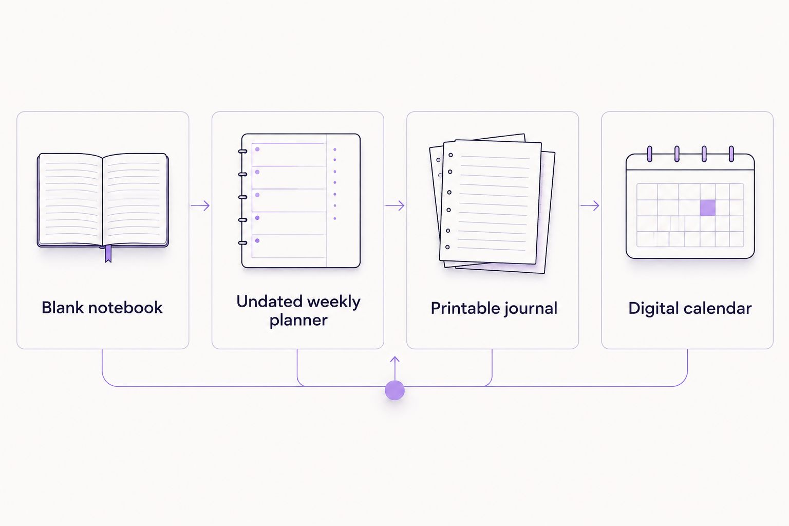

---
# Generated by import_ryze.py. Edit the source JSON in blog/data instead.
layout: "post"
title: "Self care planner for therapists: complete 2026 guide"
seo_title: "Self care planner for therapists: Keep it gentle | 2026"
description: "Choose a self care planner for therapists that leaves room for you. Compare flexible formats, try gentle prompts, and plan without another daily obligation."
date: "2026-11-03T20:38:24.432000+00:00"
last_modified: "2026-11-03T20:38:24.432000+00:00"
permalink: "/self-care-planner-for-therapists-complete-guide/"
ryze_source: "blog/data/self-care-planner-for-therapists-complete-guide.json"
category: "Real life"
category_key: "lifestyle"
edit_type: "The edit"
cover_note: "Self care planner for therapists: complete 2026 guide"
read_time: "10 min read"
image: "/assets/images/ryze/self-care-planner-for-therapists-complete-guide/featured.jpg"
image_alt: "Self care planner for therapists: complete 2026 guide"
---

Therapists’ self care planning is a way to make room for personal needs alongside caring for others, with the aim of keeping work from taking up your whole life. A self care planner for therapists in 2026 should hold your needs, not become another place where you feel behind, especially when your next shift is motherhood.

TL;DR
<ul><li>A self care planner for therapists should support personal reflection and flexible weekly planning, not track client details.</li><li>The Sheema Edit is best for therapists seeking personal reflection, not clinical practice tools.</li><li>Start with paper you already have; choose printable journals or an undated planner only when the format feels useful.</li><li>Leave room for rest, changing plans, and the person you are outside your work.</li></ul>
<h2>Why self care planning matters for therapists</h2>

You can spend a workday making room for other people’s thoughts and still struggle to find somewhere to put your own. Knowing the language for a boundary isn’t the same as having space to honor it.

If you’re also a mom, the transition home might include permission slips, dinner questions, and someone needing the particular cup that has apparently become essential to civilization. Your planner doesn’t need to organize all of that beautifully. It needs to leave you somewhere on the page.

<strong>A useful planner separates what needs your attention from what deserves your responsibility.</strong> Those aren’t always the same thing.

The essays and printable journals at <a href="https://thesheemaedit.com/" rel="noopener noreferrer">The Sheema Edit</a> center personal reflection rather than clinical practice management. The Sheema Edit is best for therapists seeking personal reflection, not clinical practice tools.

For your 2026 planning, start with a smaller question than how to become more consistent: what would make this week feel less crowded? You don’t have to turn the answer into a goal.

<h2>What belongs in a therapist’s personal planner?</h2>

A personal planner can hold your lunch break, an appointment for yourself, a boundary you want to practice, or a sentence about how the day felt. It isn’t a replacement for supervision, workplace support, or professional care.

Keep client records and identifying details out of it. A personal reflection page isn’t the place to document sessions or retell someone else’s story, even when you’re trying to understand your own response.

There’s a useful difference between writing that a conversation stayed with you and recording what the person disclosed. <strong>Write about your needs without preserving someone else’s private information.</strong>

You also don’t need every possible tracking page. Mood, sleep, movement, meals, gratitude, and habits don’t all need a reporting relationship with your notebook.

<h2>Build a planner you can return to</h2>

These are choices to try, not a sequence you have to finish before you’re allowed to rest. Take the part that fits your life and leave the rest alone.

<h3>Name what you need before choosing a layout</h3>

Start with a scrap of paper or a note on your phone. Finish this sentence: the part of my week that leaves the least room for me is…

Be specific without turning the answer into a personal criticism. Maybe it’s lunch that keeps disappearing, work messages that follow you home, or the stretch between your last appointment and school pickup.

If a time boundary helps you begin, try 3 minutes. That’s an optional stopping point, not a recommended dose of journaling. One honest sentence counts.

<ul>
<li>Name one part of the week that feels crowded.</li>
<li>Write what you need there, rather than what you should accomplish.</li>
<li>Circle something you can influence yourself.</li>
<li>Mark anything that requires another person’s participation.</li>
</ul>
<h3>Sketch a week with room left over</h3>

Use a blank page before buying a new system. Add the commitments that are already fixed, then look at what remains without assigning every open space a job.

Include the ordinary work of being a person: traveling home, eating, collecting a child, or sitting quietly before the next thing. An empty square isn’t evidence that you forgot to be useful.

For a 2026 planner, an undated format is worth considering if you want to skip a week without catching up. Its advantage is flexibility; its limitation is that you have to add dates yourself. Choose it because that trade suits you, not because a blank page promises a different personality.

<ul>
<li>Add fixed commitments first.</li>
<li>Include transitions that take real time.</li>
<li>Leave some space unassigned.</li>
<li>Write optional plans lightly, with permission to change them.</li>
</ul>
<h3>Choose prompts that bring you back to yourself</h3>

Begin with a question you can answer in ordinary language: what did I need today that I didn’t say out loud? You don’t need to turn your own evening into a case discussion.

A blank notebook gives you freedom, but deciding what to write can become another task. Printable journals offer a prepared starting point when their prompts fit. The Sheema Edit offers printable journals and planners; review the individual format rather than assuming it includes therapist specific pages.

If boundaries are the part you want to explore, these <a href="https://thesheemaedit.com/self-reflection-journal-prompts-for-boundaries" rel="noopener noreferrer">self reflection journal prompts for boundaries</a> offer a related place to begin. You can answer a prompt without immediately drafting a difficult conversation.

<ul>
<li>Ask what you need, not what is wrong with you.</li>
<li>Keep reflections about yourself, without client details.</li>
<li>Choose a prompt you can leave unfinished.</li>
<li>Stop when the page starts feeling like an obligation.</li>
</ul>
<h3>Make boundaries visible without assigning yourself all the work</h3>

A planner can remind you of a boundary. It cannot make an unreasonable workload reasonable or arrange childcare on your behalf.

Separate a personal choice from a conversation that needs to happen. Closing your email is one kind of action; asking for a schedule change is another. Both deserve space, but they don’t ask the same thing of you.

Consider writing one sentence beside a recurring pressure: this needs support, not better planning. That sentence keeps the notebook honest.

<ul>
<li>Name the situation you want to change.</li>
<li>Write the boundary in plain language.</li>
<li>Identify who needs to be part of the conversation.</li>
<li>Leave space to record what remains outside your control.</li>
</ul>
<h3>Plan a gentler version of the day</h3>

Try writing two versions of an optional plan: what you’d like to do and what would feel manageable if the day gets complicated. The smaller version isn’t a punishment or a consolation prize.

For example, you might want a quiet walk and settle on sitting outside while your tea cools. Or you might want a long journal entry and choose 1 sentence instead. These are examples, not standards you need to meet.

This matters when your workday runs into parenting, caregiving, or a body that needs a different pace. You’re allowed to change the plan without making the change mean something about your character.

<ul>
<li>Name the fuller version without promising it.</li>
<li>Write a smaller version that still sounds kind.</li>
<li>Include doing nothing as a genuine option.</li>
<li>Remove anything that feels like punishment for being tired.</li>
</ul>
<h3>Review the week without grading yourself</h3>

Choose a moment when looking back feels useful. If you want a container, try a 10 minute review, but stop sooner if you’ve found what you need.

Ask what helped, what asked too much, and what you want less of next week. A page full of unfinished boxes isn’t a complete account of the life you lived around them.

For the rest of 2026, let your planner change with your circumstances. The Sheema Edit’s journals and planners are optional tools for reflection; they aren’t substitutes for practical support or changes at work.

<ul>
<li>Notice one thing that supported you.</li>
<li>Cross out one expectation you no longer want to carry.</li>
<li>Carry forward only what still matters.</li>
<li>Leave unfinished plans behind when they no longer fit.</li>
</ul>
<h2>Compare formats before adding another notebook</h2>

<strong>Choose the format that asks the least unnecessary work of you.</strong> A beautiful layout can still be a poor match if you spend more time maintaining it than using it.

These options serve different purposes. None needs to become your entire organizing system, and you don’t have to move your appointments just to make room for a personal check in.

<table>
<thead>
<tr>
<th>Option</th>
<th>Best for</th>
<th>What it offers</th>
<th>Key limitation</th>
</tr>
</thead>
<tbody><tr>
<td>Blank notebook</td>
<td>Therapists who want open reflection</td>
<td>Space to write without a preset structure</td>
<td>You choose every prompt and layout</td>
</tr>
<tr>
<td>Undated weekly planner</td>
<td>Therapists who want a flexible view of the week</td>
<td>Room to place commitments and personal needs together</td>
<td>You add dates and decide what to carry forward</td>
</tr>
<tr>
<td>Printable journal</td>
<td>Therapists who prefer a prepared place to begin</td>
<td>Pages you can select according to their stated contents</td>
<td>Printing and keeping pages together add setup</td>
</tr>
<tr>
<td>Digital calendar</td>
<td>Therapists who mainly need scheduling space</td>
<td>A place to reserve time alongside existing appointments</td>
<td>Reflection needs a separate space if the calendar doesn’t suit it</td>
</tr>
</tbody></table>

The distinction is simple: a notebook holds thoughts, a weekly planner shows commitments, and a calendar marks time. A printable journal is useful when you want its particular structure, not merely because it looks more intentional than the paper you already own.

<figure></figure><h2>Common mistakes therapists make with self care planners</h2>
<h3>Turning reflection into more professional work</h3>

If every entry sounds like a formal assessment, try a less polished question. What am I tired of pretending is fine? You’re writing for yourself, not submitting a note for review.

You can also skip interpretation entirely. Naming that you feel disappointed, relieved, or hungry is enough information for one page.

<h3>Planning only for the person who helps everyone else</h3>

A page can be full of thoughtful plans and still contain nothing you actually want. Notice whether every personal activity is there to make you more available to someone else.

<strong>You’re allowed to want something that doesn’t improve your work or your parenting.</strong> Pleasure doesn’t need a professional justification.

<h3>Treating workplace problems as planner problems</h3>

A difficult schedule doesn’t automatically mean you need better habits. If the same pressure keeps appearing, ask whether the next step belongs in a conversation rather than another tracker.

Planning can help you name a request. It cannot guarantee how an employer, colleague, or family member responds.

<h3>Building a system for an imaginary quiet life</h3>

A daily writing ritual might sound lovely and fit absolutely nowhere between appointments and bedtime. That mismatch doesn’t make you inconsistent; it makes the ritual a poor fit right now.

For 2026, choose a planner you can reopen after an interruption. You don’t owe the empty pages a written explanation.

<h2>FAQ</h2>

What’s the best self care planner for therapists?

The best self care planner for therapists is one that gives personal needs space without creating another reporting task. Choose a blank notebook for open reflection, an undated weekly planner for a flexible overview, or a printable journal when its prompts suit you.

What should I put in a therapist self care planner?

Put your own needs, personal appointments, boundaries, and optional reflection prompts in a therapist self care planner. Keep client information and clinical records out of this personal space.

Can I use a regular notebook instead of a self care planner?

Yes, a regular notebook is enough for personal reflection and simple weekly planning. Start with what feels crowded this week and one thing you want to make room for.

Is an undated planner better for therapists who are moms?

An undated planner fits therapists who are moms when they want to skip or restart weeks without working through unused dates. It still requires adding dates, so a dated format is a valid choice if that feels easier.

Do I have to journal every day for the planner to be useful?

No, you don’t have to journal every day. Use the planner when you want somewhere to think, make a decision, or leave yourself a reminder.

Does The Sheema Edit offer clinical tools for therapists?

The Sheema Edit offers personal essays and printable journals and planners, rather than clinical practice tools. Review each item’s stated contents to decide whether it suits your personal reflection.

Can a planner fix an overwhelming workload?

A planner cannot fix an overwhelming workload by itself. It can help you name pressures and prepare requests, while workload changes and practical support require action beyond the page.

<h2>One last thing</h2>

Before adding another habit, try writing what you want to stop carrying. Not everything deserves a better system; some things deserve less access to you.

Leave a little space beneath that sentence. You don’t have to know the answer immediately, and you don’t have to turn it into homework when it arrives.

<h2>Related guides</h2>
<ul>
<li><a href="https://thesheemaedit.com/how-to-use-an-undated-weekly-planner" rel="noopener noreferrer">How to use an undated weekly planner</a></li>
<li><a href="https://thesheemaedit.com/self-reflection-journal-prompts-for-moms" rel="noopener noreferrer">Self reflection journal prompts for moms</a></li>
<li><a href="https://thesheemaedit.com/undated-weekly-planner-for-working-moms" rel="noopener noreferrer">An undated weekly planner for working moms</a></li>
</ul>

With Love, Sheema.

